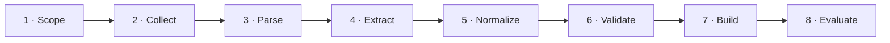

# AI4Materials Knowledge-Graph Construction Pipeline



## Pipeline overview

| Step | Input data — what enters | Process technique — one-sentence operation | Output data — what leaves |
|---|---|---|---|
| **1. Define scope and schema** | Research questions, material concepts, relation types, units, and provenance requirements. | Design an ontology and validation rules that specify allowable entities, attributes, relations, and evidence. | Versioned schema, controlled vocabulary, and competency questions. |
| **2. Collect source data** | Papers, supplementary files, databases, experiment logs, APIs, and existing knowledge graphs. | Harvest records with APIs, repository loaders, OCR/PDF parsers, and duplicate-aware metadata collection. | Raw documents, structured records, source identifiers, and acquisition metadata. |
| **3. Parse and segment** | Raw PDFs/HTML, tables, figures, captions, abstracts, and database rows. | Convert sources into text and structured spans while preserving section, table, page, and document provenance. | Clean text chunks, table records, document structure, and source offsets. |
| **4. Extract entities and relations** | Text chunks, tables, schema labels, dictionaries, and annotated examples. | Apply rules, domain NLP models, or an LLM with constrained prompts and JSON schemas to identify entities, values, events, and relations. | Candidate nodes, typed edges, property-value mentions, confidence scores, and evidence spans. |
| **5. Resolve and normalize** | Candidate mentions, chemical formulas, aliases, units, identifiers, and reference databases. | Canonicalize names and formulas, convert units, link mentions to stable IDs, and merge duplicates with deterministic rules plus embedding/LLM-assisted matching. | Canonical entities, normalized values, cross-source links, and unresolved-match queue. |
| **6. Validate and curate** | Candidate triples, ontology constraints, source evidence, confidence scores, and expert review decisions. | Run schema/SHACL checks, range and unit tests, contradiction detection, provenance checks, and targeted human or LLM review. | Accepted triples, rejected records, correction log, confidence labels, and traceable provenance. |
| **7. Build and enrich the graph** | Validated triples, ontology, identifiers, provenance, and optional numerical descriptors. | Load nodes and edges into RDF/property-graph storage, then add external links, embeddings, inferred edges, and graph-completion predictions with uncertainty. | Queryable KG, indexes, embeddings, inferred links, and graph version manifest. |
| **8. Evaluate and publish** | Graph release, gold-standard samples, benchmark questions, and target user workflows. | Measure extraction quality, entity-linking accuracy, constraint validity, coverage, and QA/prediction performance before packaging a reproducible release. | Versioned data/API, SPARQL or Cypher endpoints, benchmark report, and downloadable artifacts. |

> **Reading rule:** each project row contains one sentence for the input, process, and output; “not public” means the cited paper or repository does not expose that implementation detail.

<details>
<summary><strong>1. Define scope and schema — project details</strong></summary>

## 1. Define scope and schema

| Project | Input | Process | Output |
|---|---|---|---|
| **MatKG** | Research questions and domain concepts. | Define the schema needed for MatKG. | Entity/relation types and provenance requirements. |
| **Materials KG via LLM** | Research questions and domain concepts. | Define the schema needed for Materials KG via LLM. | Entity/relation types and provenance requirements. |
| **Propnet** | Research questions and domain concepts. | Define the schema needed for Propnet. | Entity/relation types and provenance requirements. |
| **MEKG** | Research questions and domain concepts. | Define the schema needed for MEKG. | Entity/relation types and provenance requirements. |
| **KGQA4MAT / MOF-KG** | Research questions and domain concepts. | Define the schema needed for KGQA4MAT / MOF-KG. | Entity/relation types and provenance requirements. |
| **NR-KG** | Research questions and domain concepts. | Define the schema needed for NR-KG. | Entity/relation types and provenance requirements. |
| **SolarGraph AI** | Research questions and domain concepts. | Define the schema needed for SolarGraph AI. | Entity/relation types and provenance requirements. |
| **MMKG** | Research questions and domain concepts. | Define the schema needed for MMKG. | Entity/relation types and provenance requirements. |
| **NanoMine** | Research questions and domain concepts. | Define the schema needed for NanoMine. | Entity/relation types and provenance requirements. |
| **KG-Empowered Materials Discovery** | Research questions and domain concepts. | Define the schema needed for KG-Empowered Materials Discovery. | Entity/relation types and provenance requirements. |
| **Li-Ion Cathode Semantic KG** | Research questions and domain concepts. | Define the schema needed for Li-Ion Cathode Semantic KG. | Entity/relation types and provenance requirements. |
| **Compound KG AI Assistant** | Research questions and domain concepts. | Define the schema needed for Compound KG AI Assistant. | Entity/relation types and provenance requirements. |
| **Materials Terminology KG** | Research questions and domain concepts. | Define the schema needed for Materials Terminology KG. | Entity/relation types and provenance requirements. |
| **Zeolitic Materials KG** | Research questions and domain concepts. | Define the schema needed for Zeolitic Materials KG. | Entity/relation types and provenance requirements. |
| **Upper-Level Ontology Evaluation** | Research questions and domain concepts. | Define the schema needed for Upper-Level Ontology Evaluation. | Entity/relation types and provenance requirements. |
| **LLM Extraction from Tables** | Research questions and domain concepts. | Define the schema needed for LLM Extraction from Tables. | Entity/relation types and provenance requirements. |
| **Framework Material KG** | Research questions and domain concepts. | Define the schema needed for Framework Material KG. | Entity/relation types and provenance requirements. |
| **CLASS MATE** | Research questions and domain concepts. | Define the schema needed for CLASS MATE. | Entity/relation types and provenance requirements. |
| **NIMS Materials Property KG** | Research questions and domain concepts. | Define the schema needed for NIMS Materials Property KG. | Entity/relation types and provenance requirements. |
| **LLM-Driven Materials KGs** | Research questions and domain concepts. | Define the schema needed for LLM-Driven Materials KGs. | Entity/relation types and provenance requirements. |
| **Materials Literature KG Reconstruction** | Research questions and domain concepts. | Define the schema needed for Materials Literature KG Reconstruction. | Entity/relation types and provenance requirements. |
| **ChemRxiv Materials Literature KG** | Research questions and domain concepts. | Define the schema needed for ChemRxiv Materials Literature KG. | Entity/relation types and provenance requirements. |
| **TopoMAS** | Research questions and domain concepts. | Define the schema needed for TopoMAS. | Entity/relation types and provenance requirements. |
| **TopoChat** | Research questions and domain concepts. | Define the schema needed for TopoChat. | Entity/relation types and provenance requirements. |
| **GraphAgents** | Research questions and domain concepts. | Define the schema needed for GraphAgents. | Entity/relation types and provenance requirements. |
| **Biodegradable-Polymer Expert System** | Research questions and domain concepts. | Define the schema needed for Biodegradable-Polymer Expert System. | Entity/relation types and provenance requirements. |
| **Reified KG for Emerging Materials** | Research questions and domain concepts. | Define the schema needed for Reified KG for Emerging Materials. | Entity/relation types and provenance requirements. |
| **Polymer Biodegradability GraphRAG** | Research questions and domain concepts. | Define the schema needed for Polymer Biodegradability GraphRAG. | Entity/relation types and provenance requirements. |
| **Multi-Source Heterogeneous Materials KG** | Research questions and domain concepts. | Define the schema needed for Multi-Source Heterogeneous Materials KG. | Entity/relation types and provenance requirements. |
| **OptoMatKG** | Research questions and domain concepts. | Define the schema needed for OptoMatKG. | Entity/relation types and provenance requirements. |

</details>

<details>
<summary><strong>2. Collect source data — project details</strong></summary>

## 2. Collect source data

| Project | Input | Process | Output |
|---|---|---|---|
| **MatKG** | 5M+ papers, DOI metadata. | Acquire sources through downloads, APIs, loaders, or repository datasets. | Versioned raw corpus with source identifiers. |
| **Materials KG via LLM** | energy-material abstracts and labeled JSON/Excel data. | Acquire sources through downloads, APIs, loaders, or repository datasets. | Versioned raw corpus with source identifiers. |
| **Propnet** | Materials Project or other property records. | Acquire sources through downloads, APIs, loaders, or repository datasets. | Versioned raw corpus with source identifiers. |
| **MEKG** | Materials Provenance Store PostgreSQL and Neo4j dumps. | Acquire sources through downloads, APIs, loaders, or repository datasets. | Versioned raw corpus with source identifiers. |
| **KGQA4MAT / MOF-KG** | MOF databases, literature records, and CSV triples. | Acquire sources through downloads, APIs, loaders, or repository datasets. | Versioned raw corpus with source identifiers. |
| **NR-KG** | HEA hardness/corrosion datasets and pickle graph files. | Acquire sources through downloads, APIs, loaders, or repository datasets. | Versioned raw corpus with source identifiers. |
| **SolarGraph AI** | OWL/TTL photovoltaic facts and optional OpenAlex literature. | Acquire sources through downloads, APIs, loaders, or repository datasets. | Versioned raw corpus with source identifiers. |
| **MMKG** | DBpedia and Wikipedia metallic-material records. | Acquire sources through downloads, APIs, loaders, or repository datasets. | Versioned raw corpus with source identifiers. |
| **NanoMine** | nanocomposite compositions, processes, experiments, and measurements. | Acquire sources through downloads, APIs, loaders, or repository datasets. | Versioned raw corpus with source identifiers. |
| **KG-Empowered Materials Discovery** | candidate materials, descriptors, relations, and evidence. | Acquire sources through downloads, APIs, loaders, or repository datasets. | Versioned raw corpus with source identifiers. |
| **Li-Ion Cathode Semantic KG** | cathode literature, synthesis, characterization, and performance records. | Acquire sources through downloads, APIs, loaders, or repository datasets. | Versioned raw corpus with source identifiers. |
| **Compound KG AI Assistant** | compound records and materials-discovery evidence. | Acquire sources through downloads, APIs, loaders, or repository datasets. | Versioned raw corpus with source identifiers. |
| **Materials Terminology KG** | materials-science text corpus. | Acquire sources through downloads, APIs, loaders, or repository datasets. | Versioned raw corpus with source identifiers. |
| **Zeolitic Materials KG** | zeolite/crystal/guest-species data and domain ontologies. | Acquire sources through downloads, APIs, loaders, or repository datasets. | Versioned raw corpus with source identifiers. |
| **Upper-Level Ontology Evaluation** | materials use cases plus BFO, EMMO, and PROVO. | Acquire sources through downloads, APIs, loaders, or repository datasets. | Versioned raw corpus with source identifiers. |
| **LLM Extraction from Tables** | materials-science tables and target schemas. | Acquire sources through downloads, APIs, loaders, or repository datasets. | Versioned raw corpus with source identifiers. |
| **Framework Material KG** | framework-material literature and task-specific training data. | Acquire sources through downloads, APIs, loaders, or repository datasets. | Versioned raw corpus with source identifiers. |
| **CLASS MATE** | multilingual materials documents, terminology, and graph data. | Acquire sources through downloads, APIs, loaders, or repository datasets. | Versioned raw corpus with source identifiers. |
| **NIMS Materials Property KG** | materials-property literature/corpus and domain schema. | Acquire sources through downloads, APIs, loaders, or repository datasets. | Versioned raw corpus with source identifiers. |
| **LLM-Driven Materials KGs** | materials research texts and ontology targets. | Acquire sources through downloads, APIs, loaders, or repository datasets. | Versioned raw corpus with source identifiers. |
| **Materials Literature KG Reconstruction** | materials literature text. | Acquire sources through downloads, APIs, loaders, or repository datasets. | Versioned raw corpus with source identifiers. |
| **ChemRxiv Materials Literature KG** | materials literature plus advanced preprocessed text. | Acquire sources through downloads, APIs, loaders, or repository datasets. | Versioned raw corpus with source identifiers. |
| **TopoMAS** | literature, databases, generated structures, and calculation results. | Acquire sources through downloads, APIs, loaders, or repository datasets. | Versioned raw corpus with source identifiers. |
| **TopoChat** | topological-material literature and multiple structured sources. | Acquire sources through downloads, APIs, loaders, or repository datasets. | Versioned raw corpus with source identifiers. |
| **GraphAgents** | cross-domain papers, databases, tools, and graph context. | Acquire sources through downloads, APIs, loaders, or repository datasets. | Versioned raw corpus with source identifiers. |
| **Biodegradable-Polymer Expert System** | polymer literature and domain questions. | Acquire sources through downloads, APIs, loaders, or repository datasets. | Versioned raw corpus with source identifiers. |
| **Reified KG for Emerging Materials** | emerging-material documents and statement-level evidence. | Acquire sources through downloads, APIs, loaders, or repository datasets. | Versioned raw corpus with source identifiers. |
| **Polymer Biodegradability GraphRAG** | 1,000+ PHA papers and biodegradability questions. | Acquire sources through downloads, APIs, loaders, or repository datasets. | Versioned raw corpus with source identifiers. |
| **Multi-Source Heterogeneous Materials KG** | heterogeneous materials databases, documents, and QA needs. | Acquire sources through downloads, APIs, loaders, or repository datasets. | Versioned raw corpus with source identifiers. |
| **OptoMatKG** | optoelectronic literature, structured sources, and provenance metadata. | Acquire sources through downloads, APIs, loaders, or repository datasets. | Versioned raw corpus with source identifiers. |

</details>

<details>
<summary><strong>3. Parse and segment — project details</strong></summary>

## 3. Parse and segment

| Project | Input | Process | Output |
|---|---|---|---|
| **MatKG** | 5M+ papers, DOI metadata. | Parse documents/records into model-ready text, tables, or typed fields. | Clean passages or structured records with source locations. |
| **Materials KG via LLM** | energy-material abstracts and labeled JSON/Excel data. | Parse documents/records into model-ready text, tables, or typed fields. | Clean passages or structured records with source locations. |
| **Propnet** | Materials Project or other property records. | Parse documents/records into model-ready text, tables, or typed fields. | Clean passages or structured records with source locations. |
| **MEKG** | Materials Provenance Store PostgreSQL and Neo4j dumps. | Parse documents/records into model-ready text, tables, or typed fields. | Clean passages or structured records with source locations. |
| **KGQA4MAT / MOF-KG** | MOF databases, literature records, and CSV triples. | Parse documents/records into model-ready text, tables, or typed fields. | Clean passages or structured records with source locations. |
| **NR-KG** | HEA hardness/corrosion datasets and pickle graph files. | Parse documents/records into model-ready text, tables, or typed fields. | Clean passages or structured records with source locations. |
| **SolarGraph AI** | OWL/TTL photovoltaic facts and optional OpenAlex literature. | Parse documents/records into model-ready text, tables, or typed fields. | Clean passages or structured records with source locations. |
| **MMKG** | DBpedia and Wikipedia metallic-material records. | Parse documents/records into model-ready text, tables, or typed fields. | Clean passages or structured records with source locations. |
| **NanoMine** | nanocomposite compositions, processes, experiments, and measurements. | Parse documents/records into model-ready text, tables, or typed fields. | Clean passages or structured records with source locations. |
| **KG-Empowered Materials Discovery** | candidate materials, descriptors, relations, and evidence. | Parse documents/records into model-ready text, tables, or typed fields. | Clean passages or structured records with source locations. |
| **Li-Ion Cathode Semantic KG** | cathode literature, synthesis, characterization, and performance records. | Parse documents/records into model-ready text, tables, or typed fields. | Clean passages or structured records with source locations. |
| **Compound KG AI Assistant** | compound records and materials-discovery evidence. | Parse documents/records into model-ready text, tables, or typed fields. | Clean passages or structured records with source locations. |
| **Materials Terminology KG** | materials-science text corpus. | Parse documents/records into model-ready text, tables, or typed fields. | Clean passages or structured records with source locations. |
| **Zeolitic Materials KG** | zeolite/crystal/guest-species data and domain ontologies. | Parse documents/records into model-ready text, tables, or typed fields. | Clean passages or structured records with source locations. |
| **Upper-Level Ontology Evaluation** | materials use cases plus BFO, EMMO, and PROVO. | Parse documents/records into model-ready text, tables, or typed fields. | Clean passages or structured records with source locations. |
| **LLM Extraction from Tables** | materials-science tables and target schemas. | Parse documents/records into model-ready text, tables, or typed fields. | Clean passages or structured records with source locations. |
| **Framework Material KG** | framework-material literature and task-specific training data. | Parse documents/records into model-ready text, tables, or typed fields. | Clean passages or structured records with source locations. |
| **CLASS MATE** | multilingual materials documents, terminology, and graph data. | Parse documents/records into model-ready text, tables, or typed fields. | Clean passages or structured records with source locations. |
| **NIMS Materials Property KG** | materials-property literature/corpus and domain schema. | Parse documents/records into model-ready text, tables, or typed fields. | Clean passages or structured records with source locations. |
| **LLM-Driven Materials KGs** | materials research texts and ontology targets. | Parse documents/records into model-ready text, tables, or typed fields. | Clean passages or structured records with source locations. |
| **Materials Literature KG Reconstruction** | materials literature text. | Parse documents/records into model-ready text, tables, or typed fields. | Clean passages or structured records with source locations. |
| **ChemRxiv Materials Literature KG** | materials literature plus advanced preprocessed text. | Parse documents/records into model-ready text, tables, or typed fields. | Clean passages or structured records with source locations. |
| **TopoMAS** | literature, databases, generated structures, and calculation results. | Parse documents/records into model-ready text, tables, or typed fields. | Clean passages or structured records with source locations. |
| **TopoChat** | topological-material literature and multiple structured sources. | Parse documents/records into model-ready text, tables, or typed fields. | Clean passages or structured records with source locations. |
| **GraphAgents** | cross-domain papers, databases, tools, and graph context. | Parse documents/records into model-ready text, tables, or typed fields. | Clean passages or structured records with source locations. |
| **Biodegradable-Polymer Expert System** | polymer literature and domain questions. | Parse documents/records into model-ready text, tables, or typed fields. | Clean passages or structured records with source locations. |
| **Reified KG for Emerging Materials** | emerging-material documents and statement-level evidence. | Parse documents/records into model-ready text, tables, or typed fields. | Clean passages or structured records with source locations. |
| **Polymer Biodegradability GraphRAG** | 1,000+ PHA papers and biodegradability questions. | Parse documents/records into model-ready text, tables, or typed fields. | Clean passages or structured records with source locations. |
| **Multi-Source Heterogeneous Materials KG** | heterogeneous materials databases, documents, and QA needs. | Parse documents/records into model-ready text, tables, or typed fields. | Clean passages or structured records with source locations. |
| **OptoMatKG** | optoelectronic literature, structured sources, and provenance metadata. | Parse documents/records into model-ready text, tables, or typed fields. | Clean passages or structured records with source locations. |

</details>

<details>
<summary><strong>4. Extract entities and relations — project details</strong></summary>

## 4. Extract entities and relations

| Project | Input | Process | Output |
|---|---|---|---|
| **MatKG** | Parsed text, tables, records, schema, and labels. | automated NLP and statistical relation construction; notebooks. | entity/relation CSV and N-Triples. |
| **Materials KG via LLM** | Parsed text, tables, records, schema, and labels. | fine-tuned LLaMA-7B NER/RE; ChemDataExtractor; mat2vec. | material, formula, property, application, and relation candidates. |
| **Propnet** | Parsed text, tables, records, schema, and labels. | typed Python models, equations, and unit conversion. | materials, quantities, units, and derivation dependencies. |
| **MEKG** | Parsed text, tables, records, schema, and labels. | Docker loaders, migration scripts, and Cypher. | sample, procedure, instrument, measurement, and provenance nodes. |
| **KGQA4MAT / MOF-KG** | Parsed text, tables, records, schema, and labels. | domain integration; BERT-family extraction experiments; ChatGPT query translation. | MOFs, linkers, metal nodes, properties, questions, and queries. |
| **NR-KG** | Parsed text, tables, records, schema, and labels. | Python preprocessing and PyTorch GCN. | alloy entities, relations, numeric features, and tensors. |
| **SolarGraph AI** | Parsed text, tables, records, schema, and labels. | RDFLib, SHACL, optional LLM ingestion, and Llama-3 ReAct SPARQL agent. | RDF entities, relations, evidence, and provenance. |
| **MMKG** | Parsed text, tables, records, schema, and labels. | linked-data extraction and entity alignment. | metals, compositions, properties, identifiers, and source links. |
| **NanoMine** | Parsed text, tables, records, schema, and labels. | ontology mapping of structured records. | components, formulations, workflows, properties, and evidence. |
| **KG-Empowered Materials Discovery** | Parsed text, tables, records, schema, and labels. | normalization, graph traversal, and evidence-based ranking. | canonical candidates, features, links, and recommendations. |
| **Li-Ion Cathode Semantic KG** | Parsed text, tables, records, schema, and labels. | semantic/ontology mapping; implementation details not publicly documented. | cathode materials, processes, properties, and source links. |
| **Compound KG AI Assistant** | Parsed text, tables, records, schema, and labels. | compound entity integration and assistant retrieval; public code not located. | compound nodes, properties, relations, and evidence. |
| **Materials Terminology KG** | Parsed text, tables, records, schema, and labels. | automatic terminology extraction and relation construction. | terms, concepts, semantic relations, and corpus evidence. |
| **Zeolitic Materials KG** | Parsed text, tables, records, schema, and labels. | ontology mapping, RDF integration, Blazegraph, and LLM QA. | zeolite entities, crystal facts, species links, and provenance. |
| **Upper-Level Ontology Evaluation** | Parsed text, tables, records, schema, and labels. | model equivalent domain concepts in each upper ontology and compare. | alternative ontology/KG designs. |
| **LLM Extraction from Tables** | Parsed text, tables, records, schema, and labels. | prompted LLM table-to-KG extraction. | entities, values, units, and relations from tables. |
| **Framework Material KG** | Parsed text, tables, records, schema, and labels. | LLM extraction in KGFM plus normalization and graph construction. | framework entities, attributes, relations, and evidence. |
| **CLASS MATE** | Parsed text, tables, records, schema, and labels. | cross-lingual semantic encoding and KG retrieval. | aligned terms, documents, and semantic links. |
| **NIMS Materials Property KG** | Parsed text, tables, records, schema, and labels. | NLP/LLM extraction, entity normalization, and property linking. | materials, property values, relations, and evidence. |
| **LLM-Driven Materials KGs** | Parsed text, tables, records, schema, and labels. | LLM-based entity/relation extraction and natural-language graph querying. | structured entities, triples, and query candidates. |
| **Materials Literature KG Reconstruction** | Parsed text, tables, records, schema, and labels. | LLM extraction and knowledge reconstruction in LLMs-MatLitRecon. | entities, relations, reconstructed claims, and evidence. |
| **ChemRxiv Materials Literature KG** | Parsed text, tables, records, schema, and labels. | preprocessing followed by LLM entity/relation extraction. | clean passages, entities, relations, and provenance. |
| **TopoMAS** | Parsed text, tables, records, schema, and labels. | multi-agent retrieval, generation, first-principles validation, and KG refinement. | topological-material candidates, evidence, and computed results. |
| **TopoChat** | Parsed text, tables, records, schema, and labels. | LLM retrieval and multi-source knowledge fusion. | linked passages, entities, facts, and answer evidence. |
| **GraphAgents** | Parsed text, tables, records, schema, and labels. | KG-guided agent planning, retrieval, and materials-design tool use. | entities, cross-domain relations, plans, and candidate evidence. |
| **Biodegradable-Polymer Expert System** | Parsed text, tables, records, schema, and labels. | literature retrieval and RAG over extracted polymer knowledge. | polymer entities, biodegradation facts, passages, and answers. |
| **Reified KG for Emerging Materials** | Parsed text, tables, records, schema, and labels. | reify claims, index graph context, and retrieve it for RAG. | claim nodes, qualifiers, provenance, and retrieval context. |
| **Polymer Biodegradability GraphRAG** | Parsed text, tables, records, schema, and labels. | canonicalization plus VectorRAG/GraphRAG retrieval and multi-hop reasoning. | canonical polymer entities, relations, chunks, and paths. |
| **Multi-Source Heterogeneous Materials KG** | Parsed text, tables, records, schema, and labels. | multi-source alignment, heterogeneous graph construction, and complex-query processing. | unified typed entities, relations, provenance, and query paths. |
| **OptoMatKG** | Parsed text, tables, records, schema, and labels. | traceable extraction, canonicalization, graph building, and semantic retrieval. | materials, properties, relations, evidence spans, and embeddings. |

</details>

<details>
<summary><strong>5. Resolve and normalize — project details</strong></summary>

## 5. Resolve and normalize

| Project | Input | Process | Output |
|---|---|---|---|
| **MatKG** | entity/relation CSV and N-Triples. | Canonicalize names, identifiers, formulas, values, and units; Wikidata and Materials Project linking. | Deduplicated entities and normalized relations. |
| **Materials KG via LLM** | material, formula, property, application, and relation candidates. | Canonicalize names, identifiers, formulas, values, and units; entity-resolution notebooks and PyKEEN TransE. | Deduplicated entities and normalized relations. |
| **Propnet** | materials, quantities, units, and derivation dependencies. | Canonicalize names, identifiers, formulas, values, and units; unit tests and dependency checks. | Deduplicated entities and normalized relations. |
| **MEKG** | sample, procedure, instrument, measurement, and provenance nodes. | Canonicalize names, identifiers, formulas, values, and units; database/schema constraints. | Deduplicated entities and normalized relations. |
| **KGQA4MAT / MOF-KG** | MOFs, linkers, metal nodes, properties, questions, and queries. | Canonicalize names, identifiers, formulas, values, and units; benchmark answers and query execution. | Deduplicated entities and normalized relations. |
| **NR-KG** | alloy entities, relations, numeric features, and tensors. | Canonicalize names, identifiers, formulas, values, and units; cross-validation and held-out tests. | Deduplicated entities and normalized relations. |
| **SolarGraph AI** | RDF entities, relations, evidence, and provenance. | Canonicalize names, identifiers, formulas, values, and units; SHACL validation. | Deduplicated entities and normalized relations. |
| **MMKG** | metals, compositions, properties, identifiers, and source links. | Canonicalize names, identifiers, formulas, values, and units; duplicate, identifier, and link checks. | Deduplicated entities and normalized relations. |
| **NanoMine** | components, formulations, workflows, properties, and evidence. | Canonicalize names, identifiers, formulas, values, and units; ontology conformance checks. | Deduplicated entities and normalized relations. |
| **KG-Empowered Materials Discovery** | canonical candidates, features, links, and recommendations. | Canonicalize names, identifiers, formulas, values, and units; comparison with known outcomes. | Deduplicated entities and normalized relations. |
| **Li-Ion Cathode Semantic KG** | cathode materials, processes, properties, and source links. | Canonicalize names, identifiers, formulas, values, and units; schema and evidence checks. | Deduplicated entities and normalized relations. |
| **Compound KG AI Assistant** | compound nodes, properties, relations, and evidence. | Canonicalize names, identifiers, formulas, values, and units; reported evaluation; implementation details not public. | Deduplicated entities and normalized relations. |
| **Materials Terminology KG** | terms, concepts, semantic relations, and corpus evidence. | Canonicalize names, identifiers, formulas, values, and units; quality analysis reported in the paper. | Deduplicated entities and normalized relations. |
| **Zeolitic Materials KG** | zeolite entities, crystal facts, species links, and provenance. | Canonicalize names, identifiers, formulas, values, and units; ontology consistency and repository curation. | Deduplicated entities and normalized relations. |
| **Upper-Level Ontology Evaluation** | alternative ontology/KG designs. | Canonicalize names, identifiers, formulas, values, and units; comparative criteria and competency evaluation. | Deduplicated entities and normalized relations. |
| **LLM Extraction from Tables** | entities, values, units, and relations from tables. | Canonicalize names, identifiers, formulas, values, and units; comparison with reference annotations. | Deduplicated entities and normalized relations. |
| **Framework Material KG** | framework entities, attributes, relations, and evidence. | Canonicalize names, identifiers, formulas, values, and units; paper-reported checks and downstream evaluation. | Deduplicated entities and normalized relations. |
| **CLASS MATE** | aligned terms, documents, and semantic links. | Canonicalize names, identifiers, formulas, values, and units; cross-lingual retrieval evaluation. | Deduplicated entities and normalized relations. |
| **NIMS Materials Property KG** | materials, property values, relations, and evidence. | Canonicalize names, identifiers, formulas, values, and units; case-study validation and downstream prediction tests. | Deduplicated entities and normalized relations. |
| **LLM-Driven Materials KGs** | structured entities, triples, and query candidates. | Canonicalize names, identifiers, formulas, values, and units; reported case-study checks; code not public. | Deduplicated entities and normalized relations. |
| **Materials Literature KG Reconstruction** | entities, relations, reconstructed claims, and evidence. | Canonicalize names, identifiers, formulas, values, and units; paper benchmarks and repository evaluation. | Deduplicated entities and normalized relations. |
| **ChemRxiv Materials Literature KG** | clean passages, entities, relations, and provenance. | Canonicalize names, identifiers, formulas, values, and units; preprint-reported evaluation; code not located. | Deduplicated entities and normalized relations. |
| **TopoMAS** | topological-material candidates, evidence, and computed results. | Canonicalize names, identifiers, formulas, values, and units; first-principles and self-refinement checks. | Deduplicated entities and normalized relations. |
| **TopoChat** | linked passages, entities, facts, and answer evidence. | Canonicalize names, identifiers, formulas, values, and units; reported retrieval/QA evaluation. | Deduplicated entities and normalized relations. |
| **GraphAgents** | entities, cross-domain relations, plans, and candidate evidence. | Canonicalize names, identifiers, formulas, values, and units; agent/tool feedback and reported benchmarks. | Deduplicated entities and normalized relations. |
| **Biodegradable-Polymer Expert System** | polymer entities, biodegradation facts, passages, and answers. | Canonicalize names, identifiers, formulas, values, and units; expert-system QA evaluation. | Deduplicated entities and normalized relations. |
| **Reified KG for Emerging Materials** | claim nodes, qualifiers, provenance, and retrieval context. | Canonicalize names, identifiers, formulas, values, and units; RAG benchmark comparison. | Deduplicated entities and normalized relations. |
| **Polymer Biodegradability GraphRAG** | canonical polymer entities, relations, chunks, and paths. | Canonicalize names, identifiers, formulas, values, and units; VectorRAG-versus-GraphRAG evaluation. | Deduplicated entities and normalized relations. |
| **Multi-Source Heterogeneous Materials KG** | unified typed entities, relations, provenance, and query paths. | Canonicalize names, identifiers, formulas, values, and units; reported QA and graph-quality evaluation. | Deduplicated entities and normalized relations. |
| **OptoMatKG** | materials, properties, relations, evidence spans, and embeddings. | Canonicalize names, identifiers, formulas, values, and units; provenance and retrieval evaluation. | Deduplicated entities and normalized relations. |

</details>

<details>
<summary><strong>6. Validate and curate — project details</strong></summary>

## 6. Validate and curate

| Project | Input | Process | Output |
|---|---|---|---|
| **MatKG** | Normalized records, schema, evidence, and reference answers. | Wikidata and Materials Project linking. | Accepted assertions, flagged errors, confidence, and provenance. |
| **Materials KG via LLM** | Normalized records, schema, evidence, and reference answers. | entity-resolution notebooks and PyKEEN TransE. | Accepted assertions, flagged errors, confidence, and provenance. |
| **Propnet** | Normalized records, schema, evidence, and reference answers. | unit tests and dependency checks. | Accepted assertions, flagged errors, confidence, and provenance. |
| **MEKG** | Normalized records, schema, evidence, and reference answers. | database/schema constraints. | Accepted assertions, flagged errors, confidence, and provenance. |
| **KGQA4MAT / MOF-KG** | Normalized records, schema, evidence, and reference answers. | benchmark answers and query execution. | Accepted assertions, flagged errors, confidence, and provenance. |
| **NR-KG** | Normalized records, schema, evidence, and reference answers. | cross-validation and held-out tests. | Accepted assertions, flagged errors, confidence, and provenance. |
| **SolarGraph AI** | Normalized records, schema, evidence, and reference answers. | SHACL validation. | Accepted assertions, flagged errors, confidence, and provenance. |
| **MMKG** | Normalized records, schema, evidence, and reference answers. | duplicate, identifier, and link checks. | Accepted assertions, flagged errors, confidence, and provenance. |
| **NanoMine** | Normalized records, schema, evidence, and reference answers. | ontology conformance checks. | Accepted assertions, flagged errors, confidence, and provenance. |
| **KG-Empowered Materials Discovery** | Normalized records, schema, evidence, and reference answers. | comparison with known outcomes. | Accepted assertions, flagged errors, confidence, and provenance. |
| **Li-Ion Cathode Semantic KG** | Normalized records, schema, evidence, and reference answers. | schema and evidence checks. | Accepted assertions, flagged errors, confidence, and provenance. |
| **Compound KG AI Assistant** | Normalized records, schema, evidence, and reference answers. | reported evaluation; implementation details not public. | Accepted assertions, flagged errors, confidence, and provenance. |
| **Materials Terminology KG** | Normalized records, schema, evidence, and reference answers. | quality analysis reported in the paper. | Accepted assertions, flagged errors, confidence, and provenance. |
| **Zeolitic Materials KG** | Normalized records, schema, evidence, and reference answers. | ontology consistency and repository curation. | Accepted assertions, flagged errors, confidence, and provenance. |
| **Upper-Level Ontology Evaluation** | Normalized records, schema, evidence, and reference answers. | comparative criteria and competency evaluation. | Accepted assertions, flagged errors, confidence, and provenance. |
| **LLM Extraction from Tables** | Normalized records, schema, evidence, and reference answers. | comparison with reference annotations. | Accepted assertions, flagged errors, confidence, and provenance. |
| **Framework Material KG** | Normalized records, schema, evidence, and reference answers. | paper-reported checks and downstream evaluation. | Accepted assertions, flagged errors, confidence, and provenance. |
| **CLASS MATE** | Normalized records, schema, evidence, and reference answers. | cross-lingual retrieval evaluation. | Accepted assertions, flagged errors, confidence, and provenance. |
| **NIMS Materials Property KG** | Normalized records, schema, evidence, and reference answers. | case-study validation and downstream prediction tests. | Accepted assertions, flagged errors, confidence, and provenance. |
| **LLM-Driven Materials KGs** | Normalized records, schema, evidence, and reference answers. | reported case-study checks; code not public. | Accepted assertions, flagged errors, confidence, and provenance. |
| **Materials Literature KG Reconstruction** | Normalized records, schema, evidence, and reference answers. | paper benchmarks and repository evaluation. | Accepted assertions, flagged errors, confidence, and provenance. |
| **ChemRxiv Materials Literature KG** | Normalized records, schema, evidence, and reference answers. | preprint-reported evaluation; code not located. | Accepted assertions, flagged errors, confidence, and provenance. |
| **TopoMAS** | Normalized records, schema, evidence, and reference answers. | first-principles and self-refinement checks. | Accepted assertions, flagged errors, confidence, and provenance. |
| **TopoChat** | Normalized records, schema, evidence, and reference answers. | reported retrieval/QA evaluation. | Accepted assertions, flagged errors, confidence, and provenance. |
| **GraphAgents** | Normalized records, schema, evidence, and reference answers. | agent/tool feedback and reported benchmarks. | Accepted assertions, flagged errors, confidence, and provenance. |
| **Biodegradable-Polymer Expert System** | Normalized records, schema, evidence, and reference answers. | expert-system QA evaluation. | Accepted assertions, flagged errors, confidence, and provenance. |
| **Reified KG for Emerging Materials** | Normalized records, schema, evidence, and reference answers. | RAG benchmark comparison. | Accepted assertions, flagged errors, confidence, and provenance. |
| **Polymer Biodegradability GraphRAG** | Normalized records, schema, evidence, and reference answers. | VectorRAG-versus-GraphRAG evaluation. | Accepted assertions, flagged errors, confidence, and provenance. |
| **Multi-Source Heterogeneous Materials KG** | Normalized records, schema, evidence, and reference answers. | reported QA and graph-quality evaluation. | Accepted assertions, flagged errors, confidence, and provenance. |
| **OptoMatKG** | Normalized records, schema, evidence, and reference answers. | provenance and retrieval evaluation. | Accepted assertions, flagged errors, confidence, and provenance. |

</details>

<details>
<summary><strong>7. Build and enrich the graph — project details</strong></summary>

## 7. Build and enrich the graph

| Project | Input | Process | Output |
|---|---|---|---|
| **MatKG** | Validated nodes, edges, schema, and provenance. | Load the project graph and add documented links, inference, embeddings, or predictions. | GitHub and Zenodo graph release. |
| **Materials KG via LLM** | Validated nodes, edges, schema, and provenance. | Load the project graph and add documented links, inference, embeddings, or predictions. | Neo4j-ready KG and predicted links. |
| **Propnet** | Validated nodes, edges, schema, and provenance. | Load the project graph and add documented links, inference, embeddings, or predictions. | explainable property graph via Python/Binder/web app. |
| **MEKG** | Validated nodes, edges, schema, and provenance. | Load the project graph and add documented links, inference, embeddings, or predictions. | queryable Neo4j experiment graph. |
| **KGQA4MAT / MOF-KG** | Validated nodes, edges, schema, and provenance. | Load the project graph and add documented links, inference, embeddings, or predictions. | MOF-KG data and KGQA benchmark results. |
| **NR-KG** | Validated nodes, edges, schema, and provenance. | Load the project graph and add documented links, inference, embeddings, or predictions. | trained predictors, metrics, and result files. |
| **SolarGraph AI** | Validated nodes, edges, schema, and provenance. | Load the project graph and add documented links, inference, embeddings, or predictions. | serialized RDF graph and grounded answers. |
| **MMKG** | Validated nodes, edges, schema, and provenance. | Load the project graph and add documented links, inference, embeddings, or predictions. | queryable metallic-material KG. |
| **NanoMine** | Validated nodes, edges, schema, and provenance. | Load the project graph and add documented links, inference, embeddings, or predictions. | reusable provenance-aware nanocomposite KG. |
| **KG-Empowered Materials Discovery** | Validated nodes, edges, schema, and provenance. | Load the project graph and add documented links, inference, embeddings, or predictions. | ranked candidates with graph explanations. |
| **Li-Ion Cathode Semantic KG** | Validated nodes, edges, schema, and provenance. | Load the project graph and add documented links, inference, embeddings, or predictions. | semantic cathode exploration KG. |
| **Compound KG AI Assistant** | Validated nodes, edges, schema, and provenance. | Load the project graph and add documented links, inference, embeddings, or predictions. | KG-backed discovery answers and candidates. |
| **Materials Terminology KG** | Validated nodes, edges, schema, and provenance. | Load the project graph and add documented links, inference, embeddings, or predictions. | Zenodo terminology KG dataset. |
| **Zeolitic Materials KG** | Validated nodes, edges, schema, and provenance. | Load the project graph and add documented links, inference, embeddings, or predictions. | Cambridge RDF repository and QA service. |
| **Upper-Level Ontology Evaluation** | Validated nodes, edges, schema, and provenance. | Load the project graph and add documented links, inference, embeddings, or predictions. | ontology-selection findings rather than a production KG. |
| **LLM Extraction from Tables** | Validated nodes, edges, schema, and provenance. | Load the project graph and add documented links, inference, embeddings, or predictions. | evaluated table-derived graph records. |
| **Framework Material KG** | Validated nodes, edges, schema, and provenance. | Load the project graph and add documented links, inference, embeddings, or predictions. | framework-material KG and applications. |
| **CLASS MATE** | Validated nodes, edges, schema, and provenance. | Load the project graph and add documented links, inference, embeddings, or predictions. | ranked multilingual search results. |
| **NIMS Materials Property KG** | Validated nodes, edges, schema, and provenance. | Load the project graph and add documented links, inference, embeddings, or predictions. | NIMS-deposited KG artifacts and property search. |
| **LLM-Driven Materials KGs** | Validated nodes, edges, schema, and provenance. | Load the project graph and add documented links, inference, embeddings, or predictions. | constructed KG and natural-language answers. |
| **Materials Literature KG Reconstruction** | Validated nodes, edges, schema, and provenance. | Load the project graph and add documented links, inference, embeddings, or predictions. | reconstructed materials knowledge and public code. |
| **ChemRxiv Materials Literature KG** | Validated nodes, edges, schema, and provenance. | Load the project graph and add documented links, inference, embeddings, or predictions. | literature KG described in the preprint. |
| **TopoMAS** | Validated nodes, edges, schema, and provenance. | Load the project graph and add documented links, inference, embeddings, or predictions. | validated candidates and updated KG. |
| **TopoChat** | Validated nodes, edges, schema, and provenance. | Load the project graph and add documented links, inference, embeddings, or predictions. | topological-material answers and recommendations. |
| **GraphAgents** | Validated nodes, edges, schema, and provenance. | Load the project graph and add documented links, inference, embeddings, or predictions. | design candidates with graph-grounded rationale. |
| **Biodegradable-Polymer Expert System** | Validated nodes, edges, schema, and provenance. | Load the project graph and add documented links, inference, embeddings, or predictions. | evidence-grounded polymer answers. |
| **Reified KG for Emerging Materials** | Validated nodes, edges, schema, and provenance. | Load the project graph and add documented links, inference, embeddings, or predictions. | reified KG and grounded generated answers. |
| **Polymer Biodegradability GraphRAG** | Validated nodes, edges, schema, and provenance. | Load the project graph and add documented links, inference, embeddings, or predictions. | biodegradability answers and comparative metrics. |
| **Multi-Source Heterogeneous Materials KG** | Validated nodes, edges, schema, and provenance. | Load the project graph and add documented links, inference, embeddings, or predictions. | heterogeneous KG and complex QA results. |
| **OptoMatKG** | Validated nodes, edges, schema, and provenance. | Load the project graph and add documented links, inference, embeddings, or predictions. | public GitHub KG framework and traceable answers. |

</details>

<details>
<summary><strong>8. Evaluate and publish — project details</strong></summary>

## 8. Evaluate and publish

| Project | Input | Process | Output |
|---|---|---|---|
| **MatKG** | GitHub and Zenodo graph release. | Run the documented task evaluation and package available code/data. | GitHub and Zenodo graph release. |
| **Materials KG via LLM** | Neo4j-ready KG and predicted links. | Run the documented task evaluation and package available code/data. | Neo4j-ready KG and predicted links. |
| **Propnet** | explainable property graph via Python/Binder/web app. | Run the documented task evaluation and package available code/data. | explainable property graph via Python/Binder/web app. |
| **MEKG** | queryable Neo4j experiment graph. | Run the documented task evaluation and package available code/data. | queryable Neo4j experiment graph. |
| **KGQA4MAT / MOF-KG** | MOF-KG data and KGQA benchmark results. | Run the documented task evaluation and package available code/data. | MOF-KG data and KGQA benchmark results. |
| **NR-KG** | trained predictors, metrics, and result files. | Run the documented task evaluation and package available code/data. | trained predictors, metrics, and result files. |
| **SolarGraph AI** | serialized RDF graph and grounded answers. | Run the documented task evaluation and package available code/data. | serialized RDF graph and grounded answers. |
| **MMKG** | queryable metallic-material KG. | Run the documented task evaluation and package available code/data. | queryable metallic-material KG. |
| **NanoMine** | reusable provenance-aware nanocomposite KG. | Run the documented task evaluation and package available code/data. | reusable provenance-aware nanocomposite KG. |
| **KG-Empowered Materials Discovery** | ranked candidates with graph explanations. | Run the documented task evaluation and package available code/data. | ranked candidates with graph explanations. |
| **Li-Ion Cathode Semantic KG** | semantic cathode exploration KG. | Run the documented task evaluation and package available code/data. | semantic cathode exploration KG. |
| **Compound KG AI Assistant** | KG-backed discovery answers and candidates. | Run the documented task evaluation and package available code/data. | KG-backed discovery answers and candidates. |
| **Materials Terminology KG** | Zenodo terminology KG dataset. | Run the documented task evaluation and package available code/data. | Zenodo terminology KG dataset. |
| **Zeolitic Materials KG** | Cambridge RDF repository and QA service. | Run the documented task evaluation and package available code/data. | Cambridge RDF repository and QA service. |
| **Upper-Level Ontology Evaluation** | ontology-selection findings rather than a production KG. | Run the documented task evaluation and package available code/data. | ontology-selection findings rather than a production KG. |
| **LLM Extraction from Tables** | evaluated table-derived graph records. | Run the documented task evaluation and package available code/data. | evaluated table-derived graph records. |
| **Framework Material KG** | framework-material KG and applications. | Run the documented task evaluation and package available code/data. | framework-material KG and applications. |
| **CLASS MATE** | ranked multilingual search results. | Run the documented task evaluation and package available code/data. | ranked multilingual search results. |
| **NIMS Materials Property KG** | NIMS-deposited KG artifacts and property search. | Run the documented task evaluation and package available code/data. | NIMS-deposited KG artifacts and property search. |
| **LLM-Driven Materials KGs** | constructed KG and natural-language answers. | Run the documented task evaluation and package available code/data. | constructed KG and natural-language answers. |
| **Materials Literature KG Reconstruction** | reconstructed materials knowledge and public code. | Run the documented task evaluation and package available code/data. | reconstructed materials knowledge and public code. |
| **ChemRxiv Materials Literature KG** | literature KG described in the preprint. | Run the documented task evaluation and package available code/data. | literature KG described in the preprint. |
| **TopoMAS** | validated candidates and updated KG. | Run the documented task evaluation and package available code/data. | validated candidates and updated KG. |
| **TopoChat** | topological-material answers and recommendations. | Run the documented task evaluation and package available code/data. | topological-material answers and recommendations. |
| **GraphAgents** | design candidates with graph-grounded rationale. | Run the documented task evaluation and package available code/data. | design candidates with graph-grounded rationale. |
| **Biodegradable-Polymer Expert System** | evidence-grounded polymer answers. | Run the documented task evaluation and package available code/data. | evidence-grounded polymer answers. |
| **Reified KG for Emerging Materials** | reified KG and grounded generated answers. | Run the documented task evaluation and package available code/data. | reified KG and grounded generated answers. |
| **Polymer Biodegradability GraphRAG** | biodegradability answers and comparative metrics. | Run the documented task evaluation and package available code/data. | biodegradability answers and comparative metrics. |
| **Multi-Source Heterogeneous Materials KG** | heterogeneous KG and complex QA results. | Run the documented task evaluation and package available code/data. | heterogeneous KG and complex QA results. |
| **OptoMatKG** | public GitHub KG framework and traceable answers. | Run the documented task evaluation and package available code/data. | public GitHub KG framework and traceable answers. |

</details>

## Minimal assertion contract

```text
subject ─ relation ─ object + source + location + method + confidence + graph version
```
