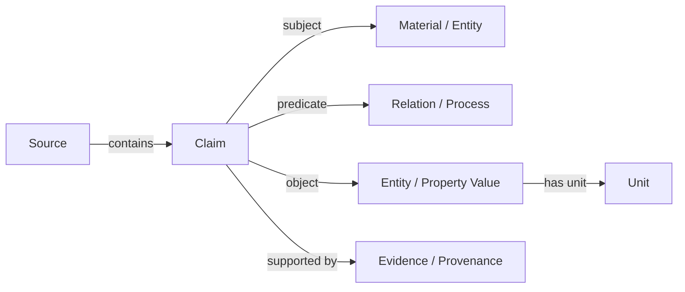

# AI4Materials Knowledge-Graph Schemas

> Each section shows the central node–relation structure reported or synthesized from the corresponding paper/repository; entries explicitly marked **conceptual** are compact interpretations because no machine-readable formal schema was located.

## Schema map

| # | Work | Core schema path |
|---:|---|---|
| 1 | [MatKG](#schema-1) | `Paper --reports--> Material` |
| 2 | [Materials Knowledge Graph via LLM](#schema-2) | `Material --has_formula--> ChemicalFormula` |
| 3 | [Propnet](#schema-3) | `Material --has_mass/has_volume--> Quantity` |
| 4 | [Materials Experiment Knowledge Graph (MEKG)](#schema-4) | `Experiment --uses_sample--> Sample` |
| 5 | [KGQA4MAT / MOF-KG](#schema-5) | `MOF --has_metal_node--> MetalNode` |
| 6 | [NR-KG](#schema-6) | `Alloy --contains--> Element` |
| 7 | [SolarGraph AI](#schema-7) | `Material --used_in--> Device` |
| 8 | [MMKG](#schema-8) | `Material --has_composition--> Composition` |
| 9 | [NanoMine](#schema-9) | `Nanocomposite --has_matrix--> Matrix` |
| 10 | [Knowledge Graph-Empowered Materials Discovery](#schema-10) | `Material --has_composition--> Composition` |
| 11 | [Semantic KG for Li-Ion Battery Cathodes](#schema-11) | `Cathode --has_composition--> Composition` |
| 12 | [Compound KG-Enabled AI Assistant](#schema-12) | `Compound --has_structure--> ChemicalStructure` |
| 13 | [Materials Terminology KG](#schema-13) | `Term --denotes--> MaterialsConcept` |
| 14 | [Knowledge Graph Representation of Zeolitic Materials](#schema-14) | `Zeolite --has_framework--> Framework` |
| 15 | [Upper-Level Ontologies for Materials KGs](#schema-15) | `Entity --participates_in--> Process` |
| 16 | [LLM Extraction from Materials Tables](#schema-16) | `Table --contains_row--> TableRow` |
| 17 | [Framework Material KG](#schema-17) | `Material --has_composition--> Composition` |
| 18 | [CLASS MATE](#schema-18) | `Term --expresses--> MaterialsConcept` |
| 19 | [Materials Property KG: NIMS Case Study](#schema-19) | `Material --has_composition--> Composition` |
| 20 | [LLM-Driven Knowledge Graphs for Materials Science](#schema-20) | `Paper --contains--> Passage` |
| 21 | [Materials Literature KG Reconstruction](#schema-21) | `Mention --resolved_to--> CanonicalMaterial` |
| 22 | [ChemRxiv Materials Literature KG](#schema-22) | `Paper --contains--> TextSegment` |
| 23 | [TopoMAS](#schema-23) | `Task --targets--> TopologicalMaterial` |
| 24 | [TopoChat](#schema-24) | `Material --has_attribute--> TopologicalFeature` |
| 25 | [GraphAgents](#schema-25) | `Task --has_objective--> DesignObjective` |
| 26 | [Biodegradable-Polymer Expert System](#schema-26) | `Polymer --has_biodegradability_claim--> BiodegradabilityClaim` |
| 27 | [Reified KG for Emerging Materials](#schema-27) | `Claim --has_subject--> Material` |
| 28 | [Polymer Biodegradability VectorRAG/GraphRAG](#schema-28) | `Mention --canonicalizes_to--> CanonicalPolymer` |
| 29 | [Multi-Source Heterogeneous Materials KG](#schema-29) | `Record --comes_from--> DatabaseSource` |
| 30 | [OptoMatKG](#schema-30) | `Material --has_composition--> Composition` |

<details>
<summary id="schema-1"><strong>1. MatKG</strong> — reported/synthesized schema</summary>

**Purpose:** A broad literature knowledge graph for materials science.

```text
Paper
  ├─ reports ───────> Material
  ├─ studies ───────> Structure
  ├─ measures ──────> Property
  └─ uses ──────────> Synthesis method
```

| Component | Schema |
|---|---|
| **Nodes** | `Paper`, `Material`, `Structure`, `Property`, `SynthesisMethod`, `Application`, `EntityIdentifier` |
| **Relations** | `Paper --reports--> Material`; `Paper --studies--> Structure`; `Paper --measures--> Property`; `Paper --uses--> SynthesisMethod`; `Material --used_in--> Application`; `Entity --linked_to--> EntityIdentifier` |

</details>

<details>
<summary id="schema-2"><strong>2. Materials Knowledge Graph via LLM</strong> — reported/synthesized schema</summary>

**Purpose:** LLM-assisted extraction of materials entities and relations from energy-materials abstracts.

```text
MAPbI3
  ├─ used_in ────────> Perovskite solar cell
  ├─ has_property ───> Band gap: 1.6 eV
  ├─ processed_by ───> Spin coating
  └─ described_in ───> Abstract and DOI
```

| Component | Schema |
|---|---|
| **Nodes** | `Material`, `ChemicalFormula`, `PropertyValue`, `Application`, `Process`, `Paper`, `Abstract`, `Claim` |
| **Relations** | `Material --has_formula--> ChemicalFormula`; `Material --has_property--> PropertyValue`; `Material --processed_by--> Process`; `Material --used_in--> Application`; `Material --described_in--> Abstract`; `Claim --supported_by--> Paper` |

</details>

<details>
<summary id="schema-3"><strong>3. Propnet</strong> — reported/synthesized schema</summary>

**Purpose:** A unit-aware graph of material properties, quantities, and property models.

```text
Material: Silicon
  ├─ has_mass ────────> 5.0 g
  ├─ has_volume ──────> 2.0 cm^3
  └─ has_property ────> Density: 2.5 g/cm^3
                           └─ generated_by ─> density = mass / volume
```

| Component | Schema |
|---|---|
| **Nodes** | `Material`, `Quantity`, `Unit`, `Property`, `PropertyModel`, `Calculation`, `DataSource` |
| **Relations** | `Material --has_mass/has_volume--> Quantity`; `Quantity --has_unit--> Unit`; `Material --has_property--> Property`; `Property --derived_from--> Quantity`; `Property --generated_by--> PropertyModel`; `PropertyModel --uses_input--> Quantity` |

</details>

<details>
<summary id="schema-4"><strong>4. Materials Experiment Knowledge Graph (MEKG)</strong> — reported/synthesized schema</summary>

**Purpose:** Experimental samples, instruments, procedures, measurements, workflows, and provenance.

```text
Experiment: E-2026-014
  ├─ uses_sample ─────> Sample: S-001
  ├─ performs_step ───> Annealing at 800 C for 2 h
  ├─ uses_instrument ─> X-ray diffractometer
  └─ produces ────────> Phase-composition measurement
```

| Component | Schema |
|---|---|
| **Nodes** | `Experiment`, `Sample`, `Material`, `ProcessStep`, `Procedure`, `Instrument`, `Measurement`, `Property`, `Dataset` |
| **Relations** | `Experiment --uses_sample--> Sample`; `Sample --composed_of--> Material`; `Experiment --performs_step--> ProcessStep`; `Experiment --uses_instrument--> Instrument`; `Experiment --produces--> Measurement`; `Measurement --measures--> Property`; `Experiment --part_of--> Dataset` |

</details>

<details>
<summary id="schema-5"><strong>5. KGQA4MAT / MOF-KG</strong> — reported/synthesized schema</summary>

**Purpose:** Metal-organic frameworks, chemical features, properties, and natural-language-to-query evaluation.

```text
MOF: UiO-66
  ├─ has_metal_node ─> Zirconium cluster
  ├─ has_linker ────> Terephthalate
  ├─ has_property ──> Surface area: 1,245 m^2/g
  └─ has_property ──> Water stability: stable
```

| Component | Schema |
|---|---|
| **Nodes** | `MOF`, `MetalNode`, `MetalIon`, `Linker`, `ChemicalComponent`, `SynthesisProcedure`, `Property`, `PropertyValue`, `Paper`, `Question`, `FormalQuery`, `Answer` |
| **Relations** | `MOF --has_metal_node--> MetalNode`; `MOF --has_linker--> Linker`; `MOF --has_component--> ChemicalComponent`; `MOF --synthesized_by--> SynthesisProcedure`; `MOF --has_property--> PropertyValue`; `Paper --describes--> MOF`; `Question --translated_to--> FormalQuery`; `FormalQuery --returns--> Answer` |

</details>

<details>
<summary id="schema-6"><strong>6. NR-KG</strong> — reported/synthesized schema</summary>

**Purpose:** High-entropy-alloy composition, graph neighborhoods, numerical properties, and prediction.

```text
Alloy: Fe-Co-Ni-Cr
  ├─ contains ───────> Element nodes
  ├─ has_property ───> Measured yield strength: 920 MPa
  └─ predicted_by ───> Graph model: 900 MPa
```

| Component | Schema |
|---|---|
| **Nodes** | `Alloy`, `Element`, `Composition`, `MeasuredProperty`, `PredictedProperty`, `Model`, `Dataset`, `Feature` |
| **Relations** | `Alloy --contains--> Element`; `Alloy --has_composition--> Composition`; `Alloy --has_measured_property--> MeasuredProperty`; `Alloy --has_predicted_property--> PredictedProperty`; `PredictedProperty --predicted_by--> Model`; `Alloy --has_feature--> Feature`; `Property --recorded_in--> Dataset` |

</details>

<details>
<summary id="schema-7"><strong>7. SolarGraph AI</strong> — reported/synthesized schema</summary>

**Purpose:** Photovoltaic materials and devices represented as an RDF/OWL graph for grounded GraphRAG.

```text
MAPbI3
  ├─ used_in ────────> Perovskite solar cell
  ├─ has_property ───> Band gap: 1.6 eV
  ├─ supported_by ────> Paper
  └─ has_provenance ──> Extraction activity
```

| Component | Schema |
|---|---|
| **Nodes** | `PhotovoltaicMaterial`, `Device`, `Property`, `QuantityValue`, `Unit`, `Paper`, `Claim`, `ExtractionActivity`, `Agent`, `Dataset` |
| **Relations** | `Material --used_in--> Device`; `Material --has_property--> QuantityValue`; `QuantityValue --has_unit--> Unit`; `Claim --supported_by--> Paper`; `Claim --generated_by--> ExtractionActivity`; `ExtractionActivity --associated_with--> Agent`; `Entity --derived_from--> Dataset` |

</details>

<details>
<summary id="schema-8"><strong>8. MMKG</strong> — reported/synthesized schema</summary>

**Purpose:** Metallic-materials graph assembled from DBpedia and Wikipedia, connecting material entities with elemental, compositional, and descriptive facts.

```text
Metallic material
  ├─ has_composition ─> Element or alloy composition
  ├─ has_property ────> Materials property
  └─ described_in ────> Linked-data source
```

| Component | Schema |
|---|---|
| **Nodes** | `MetallicMaterial`, `Metal`, `Element`, `Alloy`, `Composition`, `Property`, `WikipediaPage`, `DBpediaResource`, `ExternalIdentifier` |
| **Relations** | `Material --has_composition--> Composition`; `Composition --contains_element--> Element`; `Alloy --contains_metal--> Metal`; `Material --has_property--> Property`; `Material --described_in--> WikipediaPage`; `Material --represented_by--> DBpediaResource`; `Resource --same_as--> ExternalIdentifier` |

</details>

<details>
<summary id="schema-9"><strong>9. NanoMine</strong> — reported/synthesized schema</summary>

**Purpose:** Ontology and knowledge graph for nanocomposite components, processing workflows, experiments, and measured properties.

```text
Nanocomposite
  ├─ has_component ─> Matrix or nanofiller
  ├─ processed_by ──> Processing step
  └─ has_property ──> Measured behavior
```

| Component | Schema |
|---|---|
| **Nodes** | `Nanocomposite`, `Matrix`, `Nanofiller`, `Component`, `Formulation`, `ProcessingStep`, `Experiment`, `Measurement`, `Property`, `Condition`, `DataSource` |
| **Relations** | `Nanocomposite --has_matrix--> Matrix`; `Nanocomposite --has_filler--> Nanofiller`; `Nanocomposite --has_component--> Component`; `Nanocomposite --processed_by--> ProcessingStep`; `ProcessingStep --has_condition--> Condition`; `Experiment --uses_sample--> Nanocomposite`; `Experiment --produces--> Measurement`; `Measurement --measures--> Property` |

</details>

<details>
<summary id="schema-10"><strong>10. Knowledge Graph-Empowered Materials Discovery</strong> — reported/synthesized schema</summary>

**Purpose:** Graph-supported materials discovery and recommendation.

```text
Candidate material
  ├─ has_descriptor ─> Composition or feature
  ├─ related_to ────> Neighboring material
  └─ supported_by ──> Discovery evidence
```

| Component | Schema |
|---|---|
| **Nodes** | `CandidateMaterial`, `TargetMaterial`, `Composition`, `Descriptor`, `Feature`, `RelatedMaterial`, `Recommendation`, `DiscoveryEvidence`, `Source` |
| **Relations** | `Material --has_composition--> Composition`; `Material --has_descriptor--> Descriptor`; `Material --has_feature--> Feature`; `Material --related_to--> RelatedMaterial`; `Recommendation --concerns--> CandidateMaterial`; `Recommendation --supported_by--> DiscoveryEvidence`; `Evidence --sourced_from--> Source` |

</details>

<details>
<summary id="schema-11"><strong>11. Semantic KG for Li-Ion Battery Cathodes</strong> — reported/synthesized schema</summary>

**Purpose:** Semantic links among cathode materials, synthesis procedures, characterization methods, and electrochemical properties.

```text
Cathode material
  ├─ synthesized_by ──> Synthesis procedure
  ├─ characterized_by -> Characterization method
  └─ has_property ────> Electrochemical property
```

| Component | Schema |
|---|---|
| **Nodes** | `CathodeMaterial`, `Composition`, `SynthesisProcedure`, `ProcessingCondition`, `CharacterizationMethod`, `Measurement`, `ElectrochemicalProperty`, `PropertyValue`, `Paper` |
| **Relations** | `Cathode --has_composition--> Composition`; `Cathode --synthesized_by--> SynthesisProcedure`; `SynthesisProcedure --has_condition--> ProcessingCondition`; `Cathode --characterized_by--> CharacterizationMethod`; `CharacterizationMethod --produces--> Measurement`; `Cathode --has_property--> PropertyValue`; `Claim --supported_by--> Paper` |

</details>

<details>
<summary id="schema-12"><strong>12. Compound KG-Enabled AI Assistant</strong> — reported/synthesized schema</summary>

**Purpose:** Compound knowledge exposed through an AI assistant for discovery questions.

```text
Compound
  ├─ has_property ─> Property value
  ├─ related_to ───> Material or compound
  └─ described_in ─> Literature record
```

| Component | Schema |
|---|---|
| **Nodes** | `Compound`, `Material`, `ChemicalStructure`, `Property`, `PropertyValue`, `RelationClaim`, `Paper`, `Question`, `Answer` |
| **Relations** | `Compound --has_structure--> ChemicalStructure`; `Compound --has_property--> PropertyValue`; `Compound --related_to--> Material`; `RelationClaim --supported_by--> Paper`; `Paper --describes--> Compound`; `Question --retrieves--> Answer`; `Answer --based_on--> RelationClaim` |

</details>

<details>
<summary id="schema-13"><strong>13. Materials Terminology KG</strong> — reported/synthesized schema</summary>

**Purpose:** Automatically constructed terminology and concept graph for materials science.

```text
Materials concept
  ├─ synonym_of ─────> Related term
  ├─ related_to ─────> Scientific concept
  └─ extracted_from ─> Text corpus
```

| Component | Schema |
|---|---|
| **Nodes** | `MaterialsConcept`, `Term`, `Synonym`, `RelatedConcept`, `TextPassage`, `Corpus`, `Language` |
| **Relations** | `Term --denotes--> MaterialsConcept`; `Term --synonym_of--> Term`; `Concept --related_to--> RelatedConcept`; `Term --extracted_from--> TextPassage`; `TextPassage --part_of--> Corpus`; `Term --has_language--> Language` |

</details>

<details>
<summary id="schema-14"><strong>14. Knowledge Graph Representation of Zeolitic Materials</strong> — reported/synthesized schema</summary>

**Purpose:** Crystal, zeolite, guest-species, and structure information with LLM-based QA.

```text
Zeolitic material
  ├─ has_framework ─> Crystal framework
  ├─ contains_guest -> Guest species
  └─ has_property ──> Structural property
```

| Component | Schema |
|---|---|
| **Nodes** | `ZeoliticMaterial`, `Zeolite`, `CrystalStructure`, `Framework`, `GuestSpecies`, `ChemicalSpecies`, `Property`, `PropertyValue`, `Paper`, `EvidencePassage` |
| **Relations** | `Zeolite --has_framework--> Framework`; `Material --has_crystal_structure--> CrystalStructure`; `Material --contains_guest--> GuestSpecies`; `Material --has_property--> PropertyValue`; `Material --described_in--> Paper`; `Claim --supported_by--> EvidencePassage` |

</details>

<details>
<summary id="schema-15"><strong>15. Upper-Level Ontologies for Materials KGs</strong> — reported/synthesized schema</summary>

**Purpose:** Evaluation of BFO, EMMO, and PROVO for materials-science ontologies and KGs.

```text
Materials entity
  ├─ participates_in -> Process
  ├─ observed_by ────> Measurement activity
  └─ supported_by ────> Provenance record
```

| Component | Schema |
|---|---|
| **Nodes** | `MaterialEntity`, `Process`, `Measurement`, `Observation`, `ProvenanceRecord`, `Ontology`, `OntologyClass`, `OntologyMapping` |
| **Relations** | `Entity --participates_in--> Process`; `Entity --observed_by--> Observation`; `Observation --has_measurement--> Measurement`; `Claim --supported_by--> ProvenanceRecord`; `Entity --classified_as--> OntologyClass`; `OntologyClass --mapped_to--> OntologyClass` |

</details>

<details>
<summary id="schema-16"><strong>16. LLM Extraction from Materials Tables</strong> — reported/synthesized schema</summary>

**Purpose:** Extraction of structured materials knowledge from scientific tables.

```text
Table row
  ├─ identifies ──────> Material
  ├─ reports ─────────> Property value and unit
  ├─ uses_condition ──> Experimental condition
  └─ located_in ──────> Table and row provenance
```

| Component | Schema |
|---|---|
| **Nodes** | `Table`, `TableRow`, `TableColumn`, `Material`, `Property`, `PropertyValue`, `Unit`, `ExperimentalCondition`, `Paper`, `EvidenceCell`, `ExtractionActivity` |
| **Relations** | `Table --contains_row--> TableRow`; `Table --contains_column--> TableColumn`; `TableRow --identifies--> Material`; `TableRow --reports--> PropertyValue`; `PropertyValue --has_unit--> Unit`; `TableRow --uses_condition--> ExperimentalCondition`; `EvidenceCell --located_in--> Table`; `EvidenceCell --supports--> PropertyValue` |

</details>

<details>
<summary id="schema-17"><strong>17. Framework Material KG</strong> — reported/synthesized schema</summary>

**Purpose:** LLM-enabled knowledge graph construction for framework materials.

```text
Framework material
  ├─ has_composition ─> Chemical composition
  ├─ synthesized_by ─> Synthesis method
  ├─ characterized_by -> Characterization method
  └─ used_for ───────> Application
```

| Component | Schema |
|---|---|
| **Nodes** | `FrameworkMaterial`, `Composition`, `Element`, `Structure`, `SynthesisMethod`, `CharacterizationMethod`, `Property`, `Application`, `Paper`, `Claim`, `EvidencePassage` |
| **Relations** | `Material --has_composition--> Composition`; `Composition --contains_element--> Element`; `Material --has_structure--> Structure`; `Material --synthesized_by--> SynthesisMethod`; `Material --characterized_by--> CharacterizationMethod`; `Material --has_property--> Property`; `Material --used_for--> Application`; `Claim --supported_by--> EvidencePassage` |

</details>

<details>
<summary id="schema-18"><strong>18. CLASS MATE</strong> — reported/synthesized schema</summary>

**Purpose:** Cross-lingual semantic search for materials-science information using graph relations.

```text
Materials concept in language A
  ├─ equivalent_to ─> Concept in language B
  └─ linked_to ────> Materials-science document
```

| Component | Schema |
|---|---|
| **Nodes** | `MaterialsConcept`, `Term`, `Language`, `EquivalentConcept`, `Document`, `Passage`, `SemanticRepresentation` |
| **Relations** | `Term --expresses--> MaterialsConcept`; `Concept --has_language--> Language`; `Concept --equivalent_to--> EquivalentConcept`; `Concept --linked_to--> Document`; `Document --contains--> Passage`; `Concept --represented_by--> SemanticRepresentation`; `Term --translated_as--> Term` |

</details>

<details>
<summary id="schema-19"><strong>19. Materials Property KG: NIMS Case Study</strong> — reported/synthesized schema</summary>

**Purpose:** Materials-property relationships for search and prediction.

```text
Material
  ├─ has_property ─> Measured property value
  ├─ related_to ───> Property or material
  └─ described_in ─> Source record
```

| Component | Schema |
|---|---|
| **Nodes** | `Material`, `Composition`, `Property`, `MeasuredValue`, `PredictedValue`, `Unit`, `ExperimentalCondition`, `PredictionModel`, `SourceRecord`, `Claim` |
| **Relations** | `Material --has_composition--> Composition`; `Material --has_measured_property--> MeasuredValue`; `Material --has_predicted_property--> PredictedValue`; `Value --has_unit--> Unit`; `Measurement --has_condition--> ExperimentalCondition`; `PredictedValue --predicted_by--> PredictionModel`; `Claim --described_in--> SourceRecord` |

</details>

<details>
<summary id="schema-20"><strong>20. LLM-Driven Knowledge Graphs for Materials Science</strong> — reported/synthesized schema</summary>

**Purpose:** LLM-based graph creation and natural-language querying for materials research.

```text
Research paper
  ├─ mentions ─────> Material or process
  ├─ reports ──────> Property or result
  └─ supports ─────> Normalized graph claim
```

| Component | Schema |
|---|---|
| **Nodes** | `ResearchPaper`, `Passage`, `Material`, `Process`, `Property`, `Result`, `Claim`, `NormalizedEntity`, `EvidenceRecord` |
| **Relations** | `Paper --contains--> Passage`; `Paper --mentions--> Material`; `Paper --reports--> Result`; `Material --associated_with--> Process`; `Material --has_property--> Property`; `Claim --supports--> NormalizedEntity`; `Claim --evidenced_by--> Passage`; `EntityMention --resolved_to--> NormalizedEntity` |

</details>

<details>
<summary id="schema-21"><strong>21. Materials Literature KG Reconstruction</strong> — reported/synthesized schema</summary>

**Purpose:** Extraction and reconstruction of structured knowledge from materials literature.

```text
Literature mention
  ├─ resolved_to ───> Canonical material
  ├─ linked_to ─────> Property or process
  └─ supported_by ──> Publication passage
```

| Component | Schema |
|---|---|
| **Nodes** | `LiteratureMention`, `CanonicalMaterial`, `Property`, `Process`, `Condition`, `Publication`, `Passage`, `ReconstructedClaim`, `EntityResolutionRecord` |
| **Relations** | `Mention --resolved_to--> CanonicalMaterial`; `Mention --linked_to--> Property`; `Mention --linked_to--> Process`; `Claim --concerns--> CanonicalMaterial`; `Claim --has_condition--> Condition`; `Claim --supported_by--> Passage`; `Passage --located_in--> Publication` |

</details>

<details>
<summary id="schema-22"><strong>22. ChemRxiv Materials Literature KG</strong> — reported/synthesized schema</summary>

**Purpose:** Materials-literature KG construction using advanced preprocessing and LLM extraction.

```text
Preprocessed paper
  ├─ yields ────────> Entity and relation mentions
  ├─ normalized_to ─> Canonical graph nodes
  └─ sourced_from ──> Preprint text
```

| Component | Schema |
|---|---|
| **Nodes** | `PreprocessedPaper`, `TextSegment`, `EntityMention`, `CanonicalEntity`, `RelationMention`, `CanonicalRelation`, `Material`, `Property`, `Process`, `Preprint`, `ExtractionRecord` |
| **Relations** | `Paper --contains--> TextSegment`; `TextSegment --yields--> EntityMention`; `TextSegment --yields--> RelationMention`; `EntityMention --normalized_to--> CanonicalEntity`; `RelationMention --normalized_to--> CanonicalRelation`; `CanonicalRelation --connects--> CanonicalEntity`; `ExtractionRecord --sourced_from--> Preprint` |

</details>

<details>
<summary id="schema-23"><strong>23. TopoMAS</strong> — reported/synthesized schema</summary>

**Purpose:** Multi-agent topological-materials design with retrieval, generation, validation, and a self-refining KG.

```text
Candidate material
  ├─ generated_by ──> Design agent
  ├─ validated_by ──> First-principles calculation
  └─ recorded_in ───> Self-refining KG
```

| Component | Schema |
|---|---|
| **Nodes** | `DesignTask`, `TopologicalMaterial`, `CandidateMaterial`, `MaterialStructure`, `DesignAgent`, `ValidationAgent`, `FirstPrinciplesCalculation`, `Prediction`, `EvidenceRecord`, `SelfRefiningKG` |
| **Relations** | `Task --targets--> TopologicalMaterial`; `Candidate --generated_by--> DesignAgent`; `Candidate --has_structure--> MaterialStructure`; `Candidate --validated_by--> FirstPrinciplesCalculation`; `Candidate --predicted_by--> Prediction`; `Candidate --recorded_in--> SelfRefiningKG`; `Evidence --supports--> Candidate` |

</details>

<details>
<summary id="schema-24"><strong>24. TopoChat</strong> — reported/synthesized schema</summary>

**Purpose:** LLM retrieval assistant for topological materials using multiple knowledge sources.

```text
Topological material
  ├─ described_in ─> Literature source
  ├─ has_attribute -> Topological feature
  └─ retrieved_with -> User question
```

| Component | Schema |
|---|---|
| **Nodes** | `TopologicalMaterial`, `TopologicalFeature`, `MaterialProperty`, `LiteratureSource`, `DatabaseRecord`, `UserQuestion`, `RetrievedEvidence`, `Answer` |
| **Relations** | `Material --has_attribute--> TopologicalFeature`; `Material --has_property--> MaterialProperty`; `Material --described_in--> LiteratureSource`; `Material --represented_by--> DatabaseRecord`; `Question --retrieves--> RetrievedEvidence`; `Evidence --supports--> Answer` |

</details>

<details>
<summary id="schema-25"><strong>25. GraphAgents</strong> — reported/synthesized schema</summary>

**Purpose:** Knowledge-graph-guided agentic AI for cross-domain materials design.

```text
Design task
  ├─ constrained_by ─> Graph relation or requirement
  ├─ explored_by ────> Agent
  └─ supported_by ───> Evidence record
```

| Component | Schema |
|---|---|
| **Nodes** | `DesignTask`, `DesignObjective`, `MaterialCandidate`, `GraphConstraint`, `Agent`, `Tool`, `EvidenceRecord`, `Decision`, `DesignOutcome` |
| **Relations** | `Task --has_objective--> DesignObjective`; `Task --constrained_by--> GraphConstraint`; `Task --explored_by--> Agent`; `Agent --uses--> Tool`; `Agent --generates--> MaterialCandidate`; `Decision --based_on--> GraphConstraint`; `Decision --supported_by--> EvidenceRecord`; `Task --produces--> DesignOutcome` |

</details>

<details>
<summary id="schema-26"><strong>26. Biodegradable-Polymer Expert System</strong> — reported/synthesized schema</summary>

**Purpose:** Retrieval-augmented expert system built from biodegradable-polymer publications.

```text
Polymer
  ├─ has_biodegradability_claim -> Claim
  ├─ studied_in ────────────────> Publication
  └─ supported_by ───────────────> Evidence passage
```

| Component | Schema |
|---|---|
| **Nodes** | `Polymer`, `BiodegradabilityClaim`, `BiodegradationMechanism`, `Property`, `Publication`, `EvidencePassage`, `RetrievalQuery`, `Answer` |
| **Relations** | `Polymer --has_biodegradability_claim--> BiodegradabilityClaim`; `Claim --concerns--> Property`; `Claim --has_mechanism--> BiodegradationMechanism`; `Polymer --studied_in--> Publication`; `Claim --supported_by--> EvidencePassage`; `EvidencePassage --located_in--> Publication`; `Query --returns--> Answer` |

</details>

<details>
<summary id="schema-27"><strong>27. Reified KG for Emerging Materials</strong> — reported/synthesized schema</summary>

**Purpose:** Reified claims and evidence used to enhance RAG over emerging materials science.

```text
Claim node
  ├─ has_subject ──> Material
  ├─ has_object ───> Property or relation
  ├─ supported_by ──> Source
  └─ has_qualifier ─> Condition or uncertainty
```

| Component | Schema |
|---|---|
| **Nodes** | `Claim`, `Material`, `Property`, `Relation`, `Condition`, `UncertaintyQualifier`, `Source`, `EvidencePassage`, `ExtractionActivity` |
| **Relations** | `Claim --has_subject--> Material`; `Claim --has_predicate--> Relation`; `Claim --has_object--> Property`; `Claim --has_qualifier--> Condition`; `Claim --has_uncertainty--> UncertaintyQualifier`; `Claim --supported_by--> Source`; `Source --contains--> EvidencePassage`; `Claim --generated_by--> ExtractionActivity` |

</details>

<details>
<summary id="schema-28"><strong>28. Polymer Biodegradability VectorRAG/GraphRAG</strong> — reported/synthesized schema</summary>

**Purpose:** Comparison of vector and graph retrieval over a canonicalized polymer literature KG.

```text
Polymer claim
  ├─ canonicalizes_to -> Polymer entity
  ├─ related_to ──────> Biodegradability evidence
  └─ reported_in ─────> Publication
```

| Component | Schema |
|---|---|
| **Nodes** | `Polymer`, `PolymerMention`, `CanonicalPolymer`, `BiodegradabilityClaim`, `BiodegradabilityEvidence`, `Publication`, `Property`, `RetrievalResult` |
| **Relations** | `Mention --canonicalizes_to--> CanonicalPolymer`; `Polymer --has_claim--> BiodegradabilityClaim`; `Claim --related_to--> BiodegradabilityEvidence`; `Claim --reported_in--> Publication`; `Evidence --concerns--> Property`; `Result --retrieves--> Claim` |

</details>

<details>
<summary id="schema-29"><strong>29. Multi-Source Heterogeneous Materials KG</strong> — reported/synthesized schema</summary>

**Purpose:** Heterogeneous, multi-source graph for complex materials question answering.

```text
Material record
  ├─ comes_from ───> Database or document source
  ├─ aligned_with ─> Equivalent record
  └─ linked_to ────> Property, process, or application
```

| Component | Schema |
|---|---|
| **Nodes** | `MaterialRecord`, `CanonicalMaterial`, `DatabaseSource`, `DocumentSource`, `Property`, `Process`, `Application`, `EquivalentRecord`, `AlignmentRecord` |
| **Relations** | `Record --comes_from--> DatabaseSource`; `Record --comes_from--> DocumentSource`; `Record --aligned_with--> EquivalentRecord`; `Record --resolves_to--> CanonicalMaterial`; `Material --linked_to--> Property`; `Material --linked_to--> Process`; `Material --linked_to--> Application` |

</details>

<details>
<summary id="schema-30"><strong>30. OptoMatKG</strong> — reported/synthesized schema</summary>

**Purpose:** Traceable knowledge graph and semantic retrieval framework for optoelectronic materials science.

```text
Optoelectronic material
  ├─ has_property ─> Optical or electronic property
  ├─ used_in ──────> Device or application
  └─ supported_by ─> Source and provenance
```

| Component | Schema |
|---|---|
| **Nodes** | `OptoelectronicMaterial`, `Composition`, `OpticalProperty`, `ElectronicProperty`, `PropertyValue`, `Device`, `Application`, `Paper`, `Claim`, `ProvenanceRecord`, `RetrievalResult` |
| **Relations** | `Material --has_composition--> Composition`; `Material --has_optical_property--> OpticalProperty`; `Material --has_electronic_property--> ElectronicProperty`; `Property --has_value--> PropertyValue`; `Material --used_in--> Device`; `Device --serves_application--> Application`; `Claim --supported_by--> Paper`; `Claim --has_provenance--> ProvenanceRecord`; `Result --returns--> Claim` |

</details>

## Shared minimal schema



**Recommended assertion:** `subject + predicate + object + unit + source + evidence location + extraction method + confidence + graph version`.
